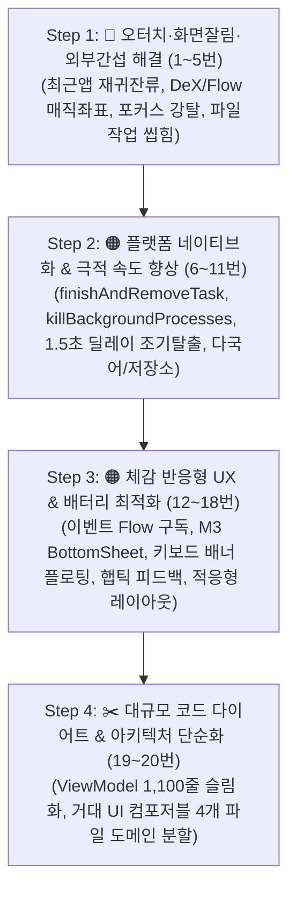

# 📋 gemgemgen 전체 코드베이스 품질·성능·UX 현대화 체크리스트

이 문서는 `gemgemgen` 프로젝트의 전체 코드베이스를 정밀 감사하여, 완료된 내역(13개)을 정리하고 **현재 남아있는 20개 핵심 현대화 과제를 시급도(위험도) 순으로 1번부터 20번까지 재배열한 체크리스트**입니다.

> 💡 **규칙**: 해결 완료된 항목은 체크박스를 체크(`- [x]`)하고, 항목명 및 본문 내용에 취소선(`~~...~~`)을 긋습니다.

---

## 📋 전체 요약 체크리스트 (시급도 순 1번 ~ 20번)

|   번호   |  체크   |     구분      | 항목명                                                                                                                                            | 관련 파일 / 모듈                                                                                                                                                                                                          |          심각도 / 작업 성격           |
| :----: | :---: | :---------: | :--------------------------------------------------------------------------------------------------------------------------------------------- | :------------------------------------------------------------------------------------------------------------------------------------------------------------------------------------------------------------------ | :----------------------------: |
| **1**  | - [ ] |  **생명주기**   | [1. 최근 앱 닫기 코루틴 취소 시 백그라운드 재귀 잔류 타 앱 종료](#1-geminiaccessibilityservicecloseappfromrecents-코루틴-취소-시-재귀-클릭-고스트-작업-잔류)                            | [`GeminiAccessibilityService.kt`](file:///c:/Users/joajo/AndroidStudioProjects/gemgemgen/app/src/main/java/com/example/gemgemgen/automation/android/GeminiAccessibilityService.kt#L275-L318)                        |       🔴 높음 (타 앱 오작동 차단)       |
| **2**  | - [ ] |   **우회로**   | [2. 최근 앱 호출 시 임의 좌표 제스처 탭(132f) 우회](#2-최근-앱recents-호출-시-표준-api-대신-임의-좌표-제스처-탭dispatchgesture-우회)                                               | [`GeminiAccessibilityService.kt`](file:///c:/Users/joajo/AndroidStudioProjects/gemgemgen/app/src/main/java/com/example/gemgemgen/automation/android/GeminiAccessibilityService.kt#L343-L372)                        |     🔴 높음 (DeX/태블릿 오터치 차단)     |
| **3**  | - [ ] |  **하드코딩**   | [3. Flow 앱 매직 좌표(437f, 1315f) 터치 및 노드 클릭 역전](#3-flow-앱-자동화의-하드코딩-매직-좌표-터치-우회-437f-1315f)                                                     | [`FlowPromptAutomation.kt`](file:///c:/Users/joajo/AndroidStudioProjects/gemgemgen/app/src/main/java/com/example/gemgemgen/automation/android/FlowPromptAutomation.kt#L68-L75)                                      |      🔴 높음 (대화면/가로모드 오터치)      |
| **4**  | - [ ] |  **UX결함**   | [4. 자동화 종료 시 메인 앱 강제 호출로 인한 포커스 강탈](#4-자동화-종료-시-무조건-메인-액티비티-강제-호출로-인한-포커스-강탈-및-플로팅-바-조기-증발)                                                  | [`AndroidAutomationHost.kt`](file:///c:/Users/joajo/AndroidStudioProjects/gemgemgen/app/src/main/java/com/example/gemgemgen/ui/android/AndroidAutomationHost.kt#L187-L190)                                          |      🔴 높음 (작업 흐름 단절 방지)       |
| **5**  | - [ ] |  **UX피드백**  | [5. 파일 입출력 작업 중 중복 요청 시 무응답 기각](#5-와일드카드-파일-입출력-작업-중-중복-요청-시-무응답-기각-silent-operation-rejection)                                              | [`WildcardViewModel.kt`](file:///c:/Users/joajo/AndroidStudioProjects/gemgemgen/app/src/main/java/com/example/gemgemgen/wildcard/ui/WildcardViewModel.kt#L615-L640)                                                 |      🔴 높음 (터치 씹힘 오해 해소)       |
| **6**  | - [ ] |   **우회로**   | [6. 자기 앱 종료 시 Recents 조작 우회 → finishAndRemoveTask](#6-자기-앱gemgemgen-프로세스-종료-시-최근-앱recents-화면을-열어-자기-카드를-찾아-닫는-기괴한-우회-로직)                     | [`AndroidGeminiAppCloser.kt`](file:///c:/Users/joajo/AndroidStudioProjects/gemgemgen/app/src/main/java/com/example/gemgemgen/automation/android/AndroidGeminiAppCloser.kt#L46-L61)                                  |    🟠 중간 (플리커 0회 & 0ms 종료)     |
| **7**  | - [ ] |   **우회로**   | [7. Google 앱 메모리 정리 설정창 매크로 → killBackgroundProcesses](#7-google-앱-메모리-정리를-위해-시스템-설정settings-앱을-화면에-띄우고-ui-매크로-클릭하는-우회-로직)                   | [`GoogleAppForceStopAutomation.kt`](file:///c:/Users/joajo/AndroidStudioProjects/gemgemgen/app/src/main/java/com/example/gemgemgen/automation/android/GoogleAppForceStopAutomation.kt#L36-L160)                     |   🟠 중간 (설정창 번쩍임 제거 & 10ms)    |
| **8**  | - [ ] |   **딜레이**   | [8. 프롬프트 파이프라인 1,550ms 고정 딜레이 누적 조기탈출](#8-프롬프트-자동화-파이프라인의-고정-딜레이1550ms-누적-및-조건부-조기-종료awaitcondition-부재)                                      | [`AccessibilityPromptAutomation.kt`](file:///c:/Users/joajo/AndroidStudioProjects/gemgemgen/app/src/main/java/com/example/gemgemgen/automation/android/AccessibilityPromptAutomation.kt#L151-L379)                  |    🟠 중간 (50회 실행 시 75초 단축)     |
| **9**  | - [ ] |   **비동기**   | [9. 블로킹 HttpURLConnection의 Dispatchers.IO 미지정](#9-androidgeminianalysisgateway-블로킹-httpurlconnection의-dispatchersio-미지정)                     | [`AndroidGeminiAnalysisGateway.kt`](file:///c:/Users/joajo/AndroidStudioProjects/gemgemgen/app/src/main/java/com/example/gemgemgen/analysis/android/AndroidGeminiAnalysisGateway.kt#L43-L115)                       | 🟠 중간 (NetworkOnMainThread 방어) |
| **10** | - [ ] |  **하드코딩**   | [10. 접근성 노드 탐색 라벨의 한국어 전용 하드코딩](#10-접근성-노드-탐색-라벨의-한국어-전용-하드코딩)                                                                                 | [`GeminiAccessibilityNodeFinder.kt`](file:///c:/Users/joajo/AndroidStudioProjects/gemgemgen/app/src/main/java/com/example/gemgemgen/automation/android/GeminiAccessibilityNodeFinder.kt#L36-L111) 외 4곳              |      🟠 중간 (영문 OS 다국어 지원)      |
| **11** | - [x] |   **저장소**   | [11. Scoped Storage 미준수 및 Deprecated Storage 경로](#11-scoped-storage-미준수-및-deprecated-environmentgetexternalstoragedirectory-의존)                | [`AndroidWildcardFileRepository.kt`](file:///c:/Users/joajo/AndroidStudioProjects/gemgemgen/app/src/main/java/com/example/gemgemgen/wildcard/android/AndroidWildcardFileRepository.kt#L342-L351)                    |     🟠 중간 (최신 OS 권한 차단 방어)     |
| **12** | - [ ] |   **이벤트**   | [12. 접근성 이벤트 무시(Unit) 및 타이머 폴링 제거](#12-접근성-이벤트를-활성화해놓고-버리는-구조-onaccessibilityevent--unit--타이머-폴링)                                              | [`GeminiAccessibilityService.kt`](file:///c:/Users/joajo/AndroidStudioProjects/gemgemgen/app/src/main/java/com/example/gemgemgen/automation/android/GeminiAccessibilityService.kt#L98-L114)                         |      🟠 중간 (배터리 및 CPU 절감)      |
| **13** | - [ ] |  **UX구조**   | [13. 거대 복합 작업(사용량/스니펫)의 모달 다이얼로그 갇힘](#13-8001100줄-규모의-거대-복합-작업이-모달-다이얼로그neumodaldialogframe에-갇혀-메인-화면-차단)                                      | [`MultiGeminiUsageDialog.kt`](file:///c:/Users/joajo/AndroidStudioProjects/gemgemgen/app/src/main/java/com/example/gemgemgen/usage/ui/MultiGeminiUsageDialog.kt#L146-L240) 외 1곳                                     |  🟠 중간 (ModalBottomSheet 전환)   |
| **14** | - [ ] |  **UI결함**   | [14. 분석 화면 상태 배너의 키보드 노출 시 은폐 및 레이아웃 점프](#14-분석-화면-상태-배너의-키보드작업-진행-중-은폐-및-레이아웃-점프)                                                             | [`AnalysisScreen.kt`](file:///c:/Users/joajo/AndroidStudioProjects/gemgemgen/app/src/main/java/com/example/gemgemgen/analysis/ui/AnalysisScreen.kt#L1171-L1458)                                                     |     🟠 중간 (에러 인지 100% 보장)      |
| **15** | - [ ] |  **인터랙션**   | [15. 앱 전반 촉각(햅틱) 피드백 0% 및 복사 비간섭 스낵바 부재](#15-앱-전반의-햅틱촉각-피드백-0-및-클립보드-복사-시-비간섭-스낵바-부재)                                                          | [`AnalysisViewModel.kt`](file:///c:/Users/joajo/AndroidStudioProjects/gemgemgen/app/src/main/java/com/example/gemgemgen/analysis/ui/AnalysisViewModel.kt#L631-L1029)                                                |      🟠 중간 (손끝 확신 UX 달성)       |
| **16** | - [ ] |   **반응형**   | [16. 태블릿/폴더블 적응형 레이아웃 부재 및 가로 100% 확장 방치](#16-태블릿폴더블-적응형-레이아웃windowsizeclass-전무-및-단일-column-확장-방치)                                             | [`MainTabbedScreen.kt`](file:///c:/Users/joajo/AndroidStudioProjects/gemgemgen/app/src/main/java/com/example/gemgemgen/ui/MainTabbedScreen.kt#L75-L80)                                                              |      🟠 중간 (대화면 최적화 레이아웃)      |
| **17** | - [x] |   **코루틴**   | [17. ThemePaletteStore 및 AppContainer의 비제어 스코프 누수](#17-themepalettestore의-stateflow-수동-수집-스코프-누수)                                              | [`ThemePaletteStore.kt`](file:///c:/Users/joajo/AndroidStudioProjects/gemgemgen/app/src/main/java/com/example/gemgemgen/ui/theme/ThemePaletteStore.kt#L29-L65)                                                      |    🟠 중간 (화면 회전 고스트 수집 차단)     |
| **18** | - [ ] | **Compose** | [18. FloatingOverlayBar의 collectAsStateWithLifecycle 미적용](#18-floatingoverlaybar의-일반-collectasstate-사용으로-생명주기-미준수)                             | [`FloatingOverlayBar.kt`](file:///c:/Users/joajo/AndroidStudioProjects/gemgemgen/app/src/main/java/com/example/gemgemgen/automation/ui/FloatingOverlayBar.kt#L33)                                                   |     🟡 낮음 (백그라운드 리컴포지션 차단)     |
| **19** | - [ ] | **코드다이어트**  | [19. 1,600줄 God ViewModel 분리 및 MultiGeminiUsageViewModel 신설](#19-1600줄-god-viewmodel-automationviewmodel-및-60개-메서드-automationscreenactions-분리) | [`AutomationViewModel.kt`](file:///c:/Users/joajo/AndroidStudioProjects/gemgemgen/app/src/main/java/com/example/gemgemgen/automation/ui/AutomationViewModel.kt#L75-L96)                                             |    ✂️ 코드 다이어트 (~1,100줄 절감)     |
| **20** | - [ ] | **코드다이어트**  | [20. 800~1,500줄 거대 모놀리식 UI 컴포저블 도메인 분리](#20-8001500줄-거대-모놀리식-ui-컴포저블의-역할별-서브-컴포넌트-분리)                                                          | [`AnalysisScreen.kt`](file:///c:/Users/joajo/AndroidStudioProjects/gemgemgen/app/src/main/java/com/example/gemgemgen/analysis/ui/AnalysisScreen.kt) 외 3곳                                                            |    ✂️ 코드 다이어트 (300줄 단위 분할)     |

---

## 1부. 🔴 오터치·화면잘림·외부간섭 해결 (Step 1)

### 1. `GeminiAccessibilityService.closeAppFromRecents` 코루틴 취소 시 재귀 클릭 고스트 작업 잔류
- **관련 파일**: [`GeminiAccessibilityService.kt` (L275-L318, L374-L424)](file:///c:/Users/joajo/AndroidStudioProjects/gemgemgen/app/src/main/java/com/example/gemgemgen/automation/android/GeminiAccessibilityService.kt#L275-L318)
- **어떤 문제인가요?**:
  - 📱 **사용자가 겪는 불편 (UX)**: 자동화를 중간에 중지했는데도 스마트폰이 혼자 최근 앱 카드를 마구 닫더니, 내가 보고 있던 메신저나 브라우저 창까지 강제로 꺼버립니다.
  - **기술적 원인**: 자동화 중지 시 continuation 콜백만 null로 만들고 `closeNextTaskCard` 재귀 루프를 취소하지 않아, 백그라운드에서 최대 10번 동안 최근 앱 카드를 닫고 마지막에 백 버튼을 날려 사용자의 다른 앱을 강제로 꺼버립니다.
- **현대화 개선 방안**:
  - `activeCloseTaskJob?.cancel()`을 명시적으로 연결하여 중지 즉시 루프를 강제 종료합니다.
- **기대 효과**:
  - 🚀 작업 취소 시 타 앱 화면 간섭 부작용 100% 방지.

---

### 2. 최근 앱(Recents) 호출 시 표준 API 대신 임의 좌표 제스처 탭(`dispatchGesture`) 우회
- **관련 파일**: [`GeminiAccessibilityService.kt` (L343-L372)](file:///c:/Users/joajo/AndroidStudioProjects/gemgemgen/app/src/main/java/com/example/gemgemgen/automation/android/GeminiAccessibilityService.kt#L343-L372)
- **어떤 문제인가요?**:
  - 📱 **사용자가 겪는 불편 (UX)**: 삼성 DeX 모드나 제스처 내비게이션 바 기기에서 최근 앱 화면 대신 홈 버튼이나 엉뚱한 앱 아이콘이 잘못 눌려 자동화가 엉뚱한 길로 샙니다.
  - **기술적 원인**: 공식 표준 API인 `performGlobalAction(GLOBAL_ACTION_RECENTS)` 대신, 하드코딩된 X좌표(`RECENTS_BUTTON_X_DP = 132f`)와 내비바 비율(`0.06125f`)을 기반으로 화면 하단을 가상 터치합니다.
- **현대화 개선 방안**:
  - `performGlobalAction(AccessibilityService.GLOBAL_ACTION_RECENTS)` 표준 API 호출로 전환합니다.
- **기대 효과**:
  - 🚀 기기 해상도, 태블릿, DeX 환경 무관하게 100% 최근 앱 호출 성공.

---

### 3. Flow 앱 자동화의 하드코딩 매직 좌표 터치 우회 (`437f, 1315f`)
- **관련 파일**: [`FlowPromptAutomation.kt` (L68-L75, L152-L165)](file:///c:/Users/joajo/AndroidStudioProjects/gemgemgen/app/src/main/java/com/example/gemgemgen/automation/android/FlowPromptAutomation.kt#L68-L75)
- **어떤 문제인가요?**:
  - 📱 **사용자가 겪는 불편 (UX)**: 태블릿이나 가로 화면에서 Flow 앱을 실행하면 입력창이 아니라 엉뚱한 허공이나 다른 버튼을 터치하여 텍스트가 입력되지 않습니다.
  - **기술적 원인**: 표준 노드 클릭(`ACTION_CLICK`)이 가능함에도 `dispatchGesture`를 1순위로 호출하며, bounds 획득 실패 시 `437f, 1315f`라는 특정 폰 세로 모드 전용 절대 좌표를 터치합니다.
- **현대화 개선 방안**:
  - 1순위로 네이티브 노드 액션(`ACTION_CLICK`, `ACTION_FOCUS`)을 실행하고, 제스처 주입은 실제 뷰 바운드가 있을 때만 동적 중심점 좌표로 격하(Fallback)합니다.
- **기대 효과**:
  - 🚀 대화면/태블릿/가로모드 오터치 원천 방지.

---

### 4. 자동화 종료 시 무조건 메인 액티비티 강제 호출로 인한 포커스 강탈 및 플로팅 바 조기 증발
- **관련 파일**: [`AndroidAutomationHost.kt` (L187-L190)](file:///c:/Users/joajo/AndroidStudioProjects/gemgemgen/app/src/main/java/com/example/gemgemgen/ui/android/AndroidAutomationHost.kt#L187-L190), [`AndroidHostPlatformNavigator.kt` (L61-L71)](file:///c:/Users/joajo/AndroidStudioProjects/gemgemgen/app/src/main/java/com/example/gemgemgen/ui/android/AndroidHostPlatformNavigator.kt#L61-L71), [`FloatingOverlayBar.kt` (L35-L39)](file:///c:/Users/joajo/AndroidStudioProjects/gemgemgen/app/src/main/java/com/example/gemgemgen/automation/ui/FloatingOverlayBar.kt#L35-L39)
- **어떤 문제인가요?**:
  - 📱 **사용자가 겪는 불편 (UX)**: 제미나이 답변을 읽고 있거나 다른 카톡을 하고 있는데, 자동화가 끝나는 순간 화면이 강제로 GemGemGen 메인 화면으로 확 바뀌며 작업 흐름이 끊깁니다. 또한 실패 시 에러를 읽을 틈도 없이 플로팅 바가 0초 만에 사라집니다.
  - **기술적 원인**: 자동화 종료 시 즉시 `startActivity(FLAG_ACTIVITY_NEW_TASK)`를 호출하여 gemgemgen 앱을 강제로 화면 전면에 띄웁니다.
- **현대화 개선 방안**:
  - 강제 액티비티 호출을 제거하고, 플로팅 바에 1.5~2초간 완료/실패 상태를 부드럽게 표시한 뒤 페이드아웃되도록 변경합니다. 메인 복귀는 알림 클릭 시 선택적으로 수행합니다.
- **기대 효과**:
  - 🚀 외부 앱 작업 방해 0%, 에러 상태 시각적 인지 보장.

---

### 5. 와일드카드 파일 입출력 작업 중 중복 요청 시 무응답 기각 (Silent Operation Rejection)
- **관련 파일**: [`WildcardViewModel.kt` (L615-L640)](file:///c:/Users/joajo/AndroidStudioProjects/gemgemgen/app/src/main/java/com/example/gemgemgen/wildcard/ui/WildcardViewModel.kt#L615-L640)
- **어떤 문제인가요?**:
  - 📱 **사용자가 겪는 불편 (UX)**: 파일 처리 중에 다른 버튼을 누르면 아무런 안내도 로딩 표시도 없이 터치가 씹혀서, 앱이 멈춘 줄 알고 버튼을 마구 연타하게 됩니다.
  - **기술적 원인**: 대용량 파일 작업 중 다른 버튼을 누르면 `if (!beginFileOperation()) return`으로 조용히 입력을 무음 리턴(Drop)합니다.
- **현대화 개선 방안**:
  - 작업 진행 중에는 UI 버튼에 로딩 뱃지/비활성화를 부여하고, 차단 시 안내 인라인 툴팁/스낵바를 표시합니다.
- **기대 효과**:
  - 🚀 터치 무응답 현상 제거 및 조작 안정감 향상.

---

## 2부. 🟠 플랫폼 네이티브화 & 극적 속도 향상 (Step 2)

### 6. 자기 앱(GemGemGen) 프로세스 종료 시 최근 앱(Recents) 화면을 열어 자기 카드를 찾아 닫는 기괴한 우회 로직
- **관련 파일**: [`AndroidGeminiAppCloser.kt` (L46-L61)](file:///c:/Users/joajo/AndroidStudioProjects/gemgemgen/app/src/main/java/com/example/gemgemgen/automation/android/AndroidGeminiAppCloser.kt#L46-L61)
- **어떤 문제인가요?**:
  - 📱 **사용자가 겪는 불편 (UX)**: 앱을 끌 때 화면이 덜컹거리며 최근 앱 목록이 번쩍 떴다가 카드가 날아가며 꺼져서 눈이 피로하고 1~2초간 멍하니 기다려야 합니다.
  - **기술적 원인**: 자기 자신 앱을 종료하는데, 접근성 서비스를 호출하여 안드로이드 최근 앱 목록(Recents)을 화면에 띄우고, 제스처를 쏘고, 화면 텍스트 노드를 순회하여 "GemGemGen 앱 종료" 버튼을 누르는 기괴한 매크로 우회 방식을 사용합니다.
- **현대화 개선 방안**:
  - 안드로이드 공식 Activity/Task 종료 API인 `activity.finishAndRemoveTask()` 또는 `android.os.Process.killProcess()`를 직접 호출하도록 교체합니다.
- **기대 효과**:
  - 🚀 화면 깜빡임 0회, 호출 즉시(0ms) 완벽한 종료, 접근성 실패율 0%.

---

### 7. Google 앱 메모리 정리를 위해 시스템 설정(Settings) 앱을 화면에 띄우고 UI 매크로 클릭하는 우회 로직
- **관련 파일**:
  - [`GoogleAppForceStopAutomation.kt` (L36-L160)](file:///c:/Users/joajo/AndroidStudioProjects/gemgemgen/app/src/main/java/com/example/gemgemgen/automation/android/GoogleAppForceStopAutomation.kt#L36-L160)
  - [`AndroidMemoryCleanupGateway.kt` (L20-L36)](file:///c:/Users/joajo/AndroidStudioProjects/gemgemgen/app/src/main/java/com/example/gemgemgen/automation/android/AndroidMemoryCleanupGateway.kt#L20-L36)
- **어떤 문제인가요?**:
  - 📱 **사용자가 겪는 불편 (UX)**: 메모리 정리를 누르면 화면에 갑자기 시스템 설정 앱이 번쩍 열리고 버튼이 스스로 눌리며 팝업이 떴다 꺼지는 시각적 깜빡임(플리커)이 발생합니다.
  - **기술적 원인**: 메모리 정리 실행 시 시스템 설정 앱을 띄워 "강제 중지" 및 다이얼로그 "확인" 버튼을 매크로로 클릭한 뒤 뒤로가기를 연타합니다. 제조사별 버튼 차이로 쉽게 깨집니다.
- **현대화 개선 방안**:
  - 안드로이드 공식 백그라운드 프로세스 정리 API인 `ActivityManager.killBackgroundProcesses(packageName)` 시스템 호출로 내재화합니다.
- **기대 효과**:
  - 🚀 설정 화면 번쩍임 0회 (완전한 백그라운드 무음 처리), 실행 시간 2초 → 10ms (100배 단축).

---

### 8. 프롬프트 자동화 파이프라인의 고정 딜레이(1,550ms) 누적 및 조건부 조기 종료(`awaitCondition`) 부재
- **관련 파일**: [`AccessibilityPromptAutomation.kt` (L151-L379)](file:///c:/Users/joajo/AndroidStudioProjects/gemgemgen/app/src/main/java/com/example/gemgemgen/automation/android/AccessibilityPromptAutomation.kt#L151-L379)
- **어떤 문제인가요?**:
  - 📱 **사용자가 겪는 불편 (UX)**: 이미 글자가 다 입력되고 준비가 끝났는데도 매 단계마다 멍하니 멈춰 대기하여, 프롬프트를 50회 연속 돌릴 때 몇 분씩 쓸데없이 기다려야 합니다.
  - **기술적 원인**: 프롬프트 1회 전송 시 `300ms(실행) + 150ms(클릭) + 500ms(반영대기) + 600ms(전송대기) = 1,550ms`의 고정 딜레이가 무조건 발생합니다. 50회 실행 시 무려 77.5초 이상의 순수 공회전 시간이 낭비됩니다.
- **현대화 개선 방안**:
  - 고정 `delay()` 대신 30ms 단위 조건 검사(`awaitCondition`)를 도입하여 텍스트 반영 및 전송이 완료되는 즉시 루프를 조기 탈출합니다.
- **기대 효과**:
  - 🚀 1회 전송당 약 1.2초 단축, 50회 반복 시 **약 60~75초 대기 시간 대폭 단축**.

---

### 9. `AndroidGeminiAnalysisGateway`: 블로킹 `HttpURLConnection`의 Dispatchers.IO 미지정
- **관련 파일**: [`AndroidGeminiAnalysisGateway.kt` (L43-L115)](file:///c:/Users/joajo/AndroidStudioProjects/gemgemgen/app/src/main/java/com/example/gemgemgen/analysis/android/AndroidGeminiAnalysisGateway.kt#L43-L115)
- **어떤 문제인가요?**:
  - 📱 **사용자가 겪는 불편 (UX)**: 네트워크를 통해 AI 분석을 요청할 때 메인 스레드가 꼬이면 에러 안내 창도 없이 앱이 바탕화면으로 튕겨버립니다.
  - **기술적 원인**: `generateContent`는 suspend 함수이지만 내부에서 `withContext(Dispatchers.IO)`를 타지 않아, 메인 스레드 호출 시 `NetworkOnMainThreadException` 크래시를 유발할 수 있습니다.
- **현대화 개선 방안**:
  - 게이트웨이 내부 전체를 `withContext(Dispatchers.IO)`로 감싸 Main-Safety를 보장합니다.
- **기대 효과**:
  - 🚀 호출자 스레드에 무관한 안전한 네트워크 실행 보장.

---

### 10. 접근성 노드 탐색 라벨의 한국어 전용 하드코딩
- **관련 파일**: [`GeminiAccessibilityNodeFinder.kt` (L36, L61, L109-L111)](file:///c:/Users/joajo/AndroidStudioProjects/gemgemgen/app/src/main/java/com/example/gemgemgen/automation/android/GeminiAccessibilityNodeFinder.kt#L36), [`FlowPromptAutomation.kt` (L168)](file:///c:/Users/joajo/AndroidStudioProjects/gemgemgen/app/src/main/java/com/example/gemgemgen/automation/android/FlowPromptAutomation.kt#L168) 외 3곳
- **어떤 문제인가요?**:
  - 📱 **사용자가 겪는 불편 (UX)**: 스마트폰 시스템 언어를 영어로 바꾸거나 해외 직구 폰에서 사용하면 버튼을 단 하나도 찾지 못해 무조건 에러가 납니다.
  - **기술적 원인**: "채팅 검색", "새 채팅", "보내기", "사이드바 닫기" 등 노드 검색 키워드가 한국어로만 하드코딩되어 있어, 영문 OS에서 노드를 찾지 못해 무조건 타임아웃 오류가 발생합니다.
- **현대화 개선 방안**:
  - `AutomationKeywords` 객체를 구축하여 한국어 및 영어("New chat", "Send", "Close sidebar" 등) 다국어 후보군 매칭을 표준 지원합니다.
- **기대 효과**:
  - 🚀 영문 단말기 및 글로벌 환경에서도 100% 정상 작동.

---

### 11. Scoped Storage 미준수 및 Deprecated `Environment.getExternalStorageDirectory()` 의존
- **관련 파일**: [`AndroidWildcardFileRepository.kt` (L342-L351)](file:///c:/Users/joajo/AndroidStudioProjects/gemgemgen/app/src/main/java/com/example/gemgemgen/wildcard/android/AndroidWildcardFileRepository.kt#L342-L351), [`AppDefaults.kt` (L11-L15)](file:///c:/Users/joajo/AndroidStudioProjects/gemgemgen/app/src/main/java/com/example/gemgemgen/core/AppDefaults.kt#L11-L15)
- **어떤 문제인가요?**:
  - 📱 **사용자가 겪는 불편 (UX)**: 안드로이드 최신 버전으로 스마트폰을 업데이트했을 때 와일드카드 폴더나 파일을 읽지 못하고 목록이 텅 비어버릴 위험이 있습니다.
  - **기술적 원인**: Android 10(API 29)부터 폐기된 `Environment.getExternalStorageDirectory()`와 하드코딩 상대경로(`"Documents/wildcard"`)에 의존하여 파일 접근 차단 위험이 있습니다.
- **현대화 개선 방안**:
  - `context.getExternalFilesDir(Environment.DIRECTORY_DOCUMENTS)` 및 SAF DocumentFile 표준 API로 완전히 일원화합니다.
- **기대 효과**:
  - 🚀 Android 최신 Scoped Storage 규격 준수 및 권한 크래시 차단.

---

## 3부. 🟠 체감 반응형 UX & 배터리 최적화 (Step 3)

### 12. 접근성 이벤트를 활성화해놓고 버리는 구조 (`onAccessibilityEvent = Unit`) + 타이머 폴링
- **관련 파일**: [`GeminiAccessibilityService.kt` (L98-L114)](file:///c:/Users/joajo/AndroidStudioProjects/gemgemgen/app/src/main/java/com/example/gemgemgen/automation/android/GeminiAccessibilityService.kt#L98-L114)
- **어떤 문제인가요?**:
  - 📱 **사용자가 겪는 불편 (UX)**: 화면이 이미 바뀌었는데도 타이머 주기(최대 0.25초)가 될 때까지 둔하게 기다렸다가 반응하여 자동화 속도가 느릿느릿하게 느껴지고 배터리가 빨리 닳습니다.
  - **기술적 원인**: OS로부터 변경 이벤트를 전달받으면서도 정작 `onAccessibilityEvent`는 비워두고, 자동화 내부에서는 80~250ms 타이머 핸들러로 화면을 계속 폴링합니다.
- **현대화 개선 방안**:
  - `SharedFlow<AccessibilityEvent>`를 통해 이벤트를 수집하고 상태 전이를 이벤트 기반으로 즉시 트리거합니다.
- **기대 효과**:
  - 🚀 타이머 폴링 제거, 이벤트 발생 즉시(0ms) 화면 전이, 배터리 절감.

---

### 13. 800~1,100줄 규모의 거대 복합 작업이 모달 다이얼로그(`NeuModalDialogFrame`)에 갇혀 메인 화면 차단
- **관련 파일**: [`MultiGeminiUsageDialog.kt` (L146-L240)](file:///c:/Users/joajo/AndroidStudioProjects/gemgemgen/app/src/main/java/com/example/gemgemgen/usage/ui/MultiGeminiUsageDialog.kt#L146-L240), [`PromptSnippetDialog.kt` (L211-L260)](file:///c:/Users/joajo/AndroidStudioProjects/gemgemgen/app/src/main/java/com/example/gemgemgen/automation/ui/PromptSnippetDialog.kt#L211-L260)
- **어떤 문제인가요?**:
  - 📱 **사용자가 겪는 불편 (UX)**: 상용구를 편집하거나 계정을 확인할 때 화면 전체가 팝업 창에 가로막혀, 작성 중이던 프롬프트 본문과 대조하며 작업할 수 없고 답답합니다.
  - **기술적 원인**: 다중 계정 로그인/관리 및 방대한 상용구 에디터 전체가 풀스크린 모달 다이얼로그 안에서 동작하여 메인 화면과의 상호작용이 차단됩니다.
- **현대화 개선 방안**:
  - M3 `ModalBottomSheet` 또는 전용 서브 화면으로 전환하여 제스처 드래그 및 배경 확인이 가능하도록 개선합니다.
- **기대 효과**:
  - 🚀 모달 갇힘 현상 해소, 작업 맥락을 유지하는 현대적 UX.

---

### 14. 분석 화면 상태 배너의 키보드/작업 진행 중 은폐 및 레이아웃 점프
- **관련 파일**: [`AnalysisScreen.kt` (L1171-L1458)](file:///c:/Users/joajo/AndroidStudioProjects/gemgemgen/app/src/main/java/com/example/gemgemgen/analysis/ui/AnalysisScreen.kt#L1171-L1458)
- **어떤 문제인가요?**:
  - 📱 **사용자가 겪는 불편 (UX)**: 키보드가 올라와 있을 때 에러 안내가 숨겨져 무슨 문제가 생겼는지 알 수 없고, 배너가 나타날 때마다 밑에 있는 버튼들이 덜컹거리며 튑니다.
  - **기술적 원인**: 키보드가 열려있거나 분석 작업 중일 때 상태 배너가 강제로 숨겨지며, 나타날 때 애니메이션 없이 하단 독 버튼 위치를 덜컹거리며 밀어냅니다.
- **현대화 개선 방안**:
  - 키보드 위로 뜨는 플로팅 `SnackbarHost`로 분리하고 `AnimatedVisibility` 트랜지션을 적용합니다.
- **기대 효과**:
  - 🚀 키보드와 무관한 100% 에러 인지 보장 및 레이아웃 시프트(CLS) 제로화.

---

### 15. 앱 전반의 햅틱(촉각) 피드백 0% 및 클립보드 복사 시 비간섭 스낵바 부재
- **관련 파일**: [`AnalysisViewModel.kt` (L631-L1029)](file:///c:/Users/joajo/AndroidStudioProjects/gemgemgen/app/src/main/java/com/example/gemgemgen/analysis/ui/AnalysisViewModel.kt#L631-L1029), [`AndroidSoundAlertGateway.kt` (L18)](file:///c:/Users/joajo/AndroidStudioProjects/gemgemgen/app/src/main/java/com/example/gemgemgen/core/android/AndroidSoundAlertGateway.kt#L18)
- **어떤 문제인가요?**:
  - 📱 **사용자가 겪는 불편 (UX)**: 프롬프트를 복사하거나 버튼을 눌러도 손끝에 톡 치는 진동이나 스낵바 안내가 전혀 없어, 제대로 복사된 건지 눈으로 확인하기 전엔 알 수 없습니다.
  - **기술적 원인**: 앱 전체에 `LocalHapticFeedback` 호출이 단 0건이며, 무음 모드 기기에서는 프롬프트 복사나 자동화 시작/완료 여부를 촉각으로 전혀 인지할 수 없습니다.
- **현대화 개선 방안**:
  - 복사 시 가벼운 틱(Tick), 성공 시 부드러운 진동, 에러 시 경고 진동을 제공하고 비간섭 플로팅 스낵바를 호출합니다.
- **기대 효과**:
  - 🚀 손끝 감각으로 조작 성공을 확신하는 모바일 반응형 UX 달성.

---

### 16. 태블릿/폴더블 적응형 레이아웃(WindowSizeClass) 전무 및 단일 Column 확장 방치
- **관련 파일**: [`MainTabbedScreen.kt` (L75-L80)](file:///c:/Users/joajo/AndroidStudioProjects/gemgemgen/app/src/main/java/com/example/gemgemgen/ui/MainTabbedScreen.kt#L75-L80), `AutomationScreen.kt` 외
- **어떤 문제인가요?**:
  - 📱 **사용자가 겪는 불편 (UX)**: 태블릿이나 폴더블을 펼쳤을 때 카드가 모니터 끝에서 끝까지 기괴하게 길게 늘어나서 눈동자를 좌우로 심하게 굴려야 합니다.
  - **기술적 원인**: 프로젝트 전역에 대화면 분기 코드가 없어 태블릿 가로 모드나 폴더블 대화면에서 카드가 가로 100%로 무한히 길게 늘어납니다.
- **현대화 개선 방안**:
  - 대화면(`Expanded`) 감지 시 중앙 정렬 최대 너비 제한(`Modifier.widthIn(max = 680.dp)`)을 적용합니다.
- **기대 효과**:
  - 🚀 태블릿/폴더블/DeX 환경에서 대화면 최적화 뷰 제공.

---

### 17. `ThemePaletteStore`의 StateFlow 수동 수집 스코프 누수
- **관련 파일**: [`ThemePaletteStore.kt` (L29, L56-L65)](file:///c:/Users/joajo/AndroidStudioProjects/gemgemgen/app/src/main/java/com/example/gemgemgen/ui/theme/ThemePaletteStore.kt#L29)
- **어떤 문제인가요?**:
  - 📱 **사용자가 겪는 불편 (UX)**: 스마트폰을 가로로 돌렸다가 세로로 돌릴 때마다 앱 내부에서 보이지 않는 유령 작업이 쌓여 폰이 점점 버벅거리고 메모리를 갉아먹습니다.
  - **기술적 원인**: 화면 회전 시 취소되지 않는 독자적 `CoroutineScope`로 DataStore 이벤트를 수동 수집하여 고스트 코루틴이 누적됩니다.
- **현대화 개선 방안**:
  - `stateIn(WhileSubscribed(5000))` 선언적 StateFlow로 전환합니다.
- **기대 효과**:
  - 🚀 화면 회전 시 고스트 수집 코루틴 완전 제거.

---

### 18. `FloatingOverlayBar`의 일반 `collectAsState()` 사용으로 생명주기 미준수
- **관련 파일**: [`FloatingOverlayBar.kt` (L33)](file:///c:/Users/joajo/AndroidStudioProjects/gemgemgen/app/src/main/java/com/example/gemgemgen/automation/ui/FloatingOverlayBar.kt#L33)
- **어떤 문제인가요?**:
  - 📱 **사용자가 겪는 불편 (UX)**: 플로팅 바를 안 보고 다른 작업을 할 때도 뒤에서 화면을 계속 갱신하느라 폰 배터리가 불필요하게 닳습니다.
  - **기술적 원인**: 오버레이 뷰가 가려지거나 멈춰있는 상태에서도 일반 `collectAsState()`로 인해 백그라운드 불필요 리컴포지션이 발생합니다.
- **현대화 개선 방안**:
  - `collectAsStateWithLifecycle()`로 교체합니다.
- **기대 효과**:
  - 🚀 백그라운드 오버레이 CPU 낭비 방지.

---

## 4부. ✂️ 대규모 코드 다이어트 & 아키텍처 단순화 (Step 4)

### 19. 1,600줄 God ViewModel `AutomationViewModel` 및 60개 메서드 `AutomationScreenActions` 분리
- **관련 파일**:
  - 메인 뷰모델: [`AutomationViewModel.kt` (L75-L96, 1,627줄)](file:///c:/Users/joajo/AndroidStudioProjects/gemgemgen/app/src/main/java/com/example/gemgemgen/automation/ui/AutomationViewModel.kt#L75-L96)
  - 메인 액션 인터페이스: [`AutomationScreenActions.kt` (L14-L125)](file:///c:/Users/joajo/AndroidStudioProjects/gemgemgen/app/src/main/java/com/example/gemgemgen/automation/ui/AutomationScreenActions.kt#L14-L125)
- **어떤 문제인가요?**:
  - 📱 **사용자가 겪는 불편 (UX)**: 계정 사용량 화면 하나만 수정해도 전체 자동화 기능에 연쇄 버그가 터질 위험이 높아 앱 안정성을 해칩니다.
  - **기술적 원인**: 19개의 의존성을 주입받아 자동화, 상용구 CRUD, 연금술, 계정 사용량, 원격 자동화 등 9개 도메인을 1개 클래스에서 총괄 관리하고 있어 테스트 및 안정화가 어렵습니다.
- **현대화 개선 방안**:
  - `usage` 전용 `MultiGeminiUsageViewModel`을 신설하여 150줄 분량의 계정 위임 코드를 분리하고, 상용구/실험 액션을 전용 Coordinator로 위임합니다.
- **기대 효과**:
  - ✂️ `AutomationViewModel.kt` 코드 라인 **1,627줄 → 약 450~500줄로 대폭 슬림화 (약 1,100줄 절감)**, 생성자 파라미터 19개 → 7개 축소.

---

### 20. 800~1,500줄 거대 모놀리식 UI 컴포저블의 역할별 서브 컴포넌트 분리
- **관련 파일**:
  - [`AnalysisScreen.kt` (1,495줄)](file:///c:/Users/joajo/AndroidStudioProjects/gemgemgen/app/src/main/java/com/example/gemgemgen/analysis/ui/AnalysisScreen.kt)
  - [`PromptSnippetDialog.kt` (1,138줄)](file:///c:/Users/joajo/AndroidStudioProjects/gemgemgen/app/src/main/java/com/example/gemgemgen/automation/ui/PromptSnippetDialog.kt)
  - [`GeminiAccountRowCard.kt` (890줄)](file:///c:/Users/joajo/AndroidStudioProjects/gemgemgen/app/src/main/java/com/example/gemgemgen/usage/ui/GeminiAccountRowCard.kt)
  - [`PromptExperimentDialog.kt` (842줄)](file:///c:/Users/joajo/AndroidStudioProjects/gemgemgen/app/src/main/java/com/example/gemgemgen/automation/ui/PromptExperimentDialog.kt)
- **어떤 문제인가요?**:
  - 📱 **사용자가 겪는 불편 (UX)**: 분석 화면에서 글자 하나만 쳐도 전체 1,500줄 화면이 통째로 다시 그려지며 타이핑 시 미세한 렉(지연)과 버벅거림이 발생합니다.
  - **기술적 원인**: 파일 하나에 1,000줄 이상의 방대한 뷰/상태 코드가 모놀리식으로 합쳐져 있어 Compose 스마트 리컴포지션 추적 어려움을 초래합니다.
- **현대화 개선 방안**:
  - `AnalysisScreen.kt`를 헤더바, 프롬프트 입력 섹션, 방향 선택 섹션, 결과 표시 섹션 등 300~400줄 단위 전용 서브 파일로 분리합니다.
- **기대 효과**:
  - ✂️ 컴포넌트별 리컴포지션 최적화 및 유지보수 가독성 극대화.

---

## 🗺️ 시급도 순 4단계 현대화 로드맵

### 1. Step 1 (🔴 오터치·화면잘림·외부간섭 해결)
- [ ] 1. 최근 앱 닫기 코루틴 취소 시 재귀 루프 강제 취소(`activeCloseTaskJob?.cancel()`)
- [ ] 2. 최근 앱 호출 시 임의 좌표 터치(132f) → `performGlobalAction(GLOBAL_ACTION_RECENTS)` 전환
- [ ] 3. Flow 앱 매직 좌표(`437f, 1315f`) 터치 제거 및 노드 액션 우선순위 정상화
- [ ] 4. 자동화 종료 시 강제 `startActivity(NEW_TASK)` 포커스 강탈 제거 및 비간섭 피드백
- [ ] 5. 와일드카드 파일 작업 중복 요청 시 무응답 기각 제거 및 로딩/스낵바 피드백

### 2. Step 2 (🟠 플랫폼 네이티브화 & 극적 속도 향상)
- [ ] 6. 자기 앱 종료 시 Recents 조작 우회 → `activity.finishAndRemoveTask()` 네이티브 API 전환
- [ ] 7. Google 앱 메모리 정리 설정창 매크로 클릭 → `ActivityManager.killBackgroundProcesses()` 전환
- [ ] 8. 프롬프트 자동화 파이프라인 고정 딜레이(1,550ms) 조건부 조기 종료(`awaitCondition`) 전환
- [ ] 9. `AndroidGeminiAnalysisGateway` Main-Safe 보장 (`withContext(Dispatchers.IO)`)
- [ ] 10. 접근성 노드 탐색 라벨 다국어(`AutomationKeywords`) 표준 지원
- [x] 11. Deprecated `getExternalStorageDirectory()` 의존 Scoped Storage 단일화

### 3. Step 3 (🟠 체감 반응형 UX & 배터리 최적화)
- [ ] 12. `GeminiAccessibilityService` 접근성 이벤트 Flow 구독 및 타이머 폴링 제거
- [ ] 13. 거대 복합 다이얼로그의 M3 `ModalBottomSheet` 전환
- [ ] 14. 분석 화면 상태 배너 키보드 플로팅화 및 레이아웃 점프 해소
- [ ] 15. 프로젝트 전반 `LocalHapticFeedback` 촉각 반응 및 비간섭 복사 스낵바 도입
- [ ] 16. 태블릿/대화면 가로 너비 상한 제한(`widthIn(max = 680.dp)`)
- [x] 17. `ThemePaletteStore`의 StateFlow 선언 `stateIn(WhileSubscribed)` 전환
- [ ] 18. `FloatingOverlayBar`의 `collectAsStateWithLifecycle()` 전환

### 4. Step 4 (✂️ 대규모 코드 다이어트 & 아키텍처 단순화)
- [ ] 19. `AutomationViewModel` 1,600줄 슬림화 & `MultiGeminiUsageViewModel` 독립 분리 (**약 1,100줄 절감**)
- [ ] 20. 800~1,500줄 거대 UI 컴포저블 4개 파일 도메인 분할
