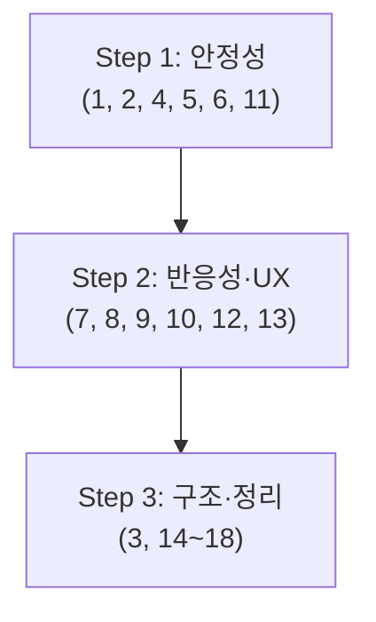

# 📋 gemgemgen 코드 현대화 체크리스트

`modernize-code-patterns` 스킬(6대 축) 기준 감사 결과입니다. 서브에이전트 4기가 읽기 전용으로 조사했고, 일부는 grep 기반이라 **착수 전 해당 줄 재확인이 필요**합니다. (경로 기준: `app/src/main/java/com/example/gemgemgen/`)

> 💡 **규칙**: 해결한 항목은 `- [x]`로 체크하고 항목명에 취소선(`~~...~~`)을 긋습니다.

---

## 📋 전체 요약 체크리스트

| 체크 | 구분 | 항목명 | 관련 위치 | 심각도 |
| :---: | :---: | :--- | :--- | :---: |
| - [ ] | 블로킹 | 1. DataStore `runBlocking` 동기 접근 제거 | `remote/android/RemoteAutomationStore.kt` 외 7곳 | 🔴 |
| - [ ] | 블로킹 | 2. 자동화 시작 경로의 설정 읽기 `runBlocking` | `automation/android/AndroidAutomationRuntime.kt#L58` | 🔴 |
| - [ ] | 저장소 | 3. Scoped Storage 우회(전체 파일 접근) 이중 경로 | `wildcard/android/AndroidWildcardFileRepository.kt#L335-L389` | 🔴 |
| - [ ] | 데이터 | 4. 와일드카드 파일 비원자적 저장 | `AndroidWildcardFileRepository.kt#L276-L286` | 🟠 |
| - [ ] | 블로킹 | 5. 와일드카드 파일 동기 I/O 호출 스레드 | `AndroidWildcardFileRepository.kt#L65,L252,L278` | 🟠 |
| - [ ] | 보안 | 6. 쿠키 JSON 평문 SharedPreferences 저장 | `usage/android/GeminiAccountCookieVault` L45 | 🟠 |
| - [ ] | 딜레이 | 7. 접근성 자동화 고정 delay → 이벤트/조건 폴링 | `automation/android/AccessibilityPromptAutomation.kt` | 🟠 |
| - [ ] | 우회로 | 8. Dex 최근앱 버튼 좌표 탭 | `automation/android/GeminiAccessibilityService.kt#L342-L370` | 🟠 |
| - [ ] | 우회로 | 9. IME 강제 변경 + adb 권한 의존 | `automation/android/AndroidImeSettings.kt` | 🟠 |
| - [ ] | 하드코딩 | 10. 외부 앱 view-ID·키보드 패키지 산재 | `automation/android/GeminiAccountSwitchAutomation.kt` 외 | 🟠 |
| - [ ] | 재시도 | 11. Grok 로그인 폴링·Gemini 재시도 백오프/상한 | `ManageGrokAuthUseCase.kt#L39-L70`, `AndroidGeminiAnalysisGateway.kt#L55-L80` | 🟠 |
| - [ ] | UI | 12. 테마 팔레트 밖 하드코딩 색상 | `AnalysisScreen.kt#L1436`, `StatusSettingsDialog.kt#L54` 외 | 🟠 |
| - [ ] | UI | 13. 와일드카드 LazyColumn 불안정 key | `wildcard/ui/WildcardEditorComponents.kt#L72-L75` | 🟠 |
| - [ ] | 생명주기 | 14. `collectAsState` → `collectAsStateWithLifecycle`, 30초 루프, 스코프 cancel | usage/ui, FloatingOverlayBar, Service | 🟡 |
| - [ ] | UI | 15. 고정 sp/dp·터치 타깃 | `AutomationModePanel.kt#L66-L112` 외 | 🟡 |
| - [ ] | 하드코딩 | 16. Receiver 액션 문자열 패키지명 | `RemoteAutomationReceiverService.kt#L676-L678` | 🟡 |
| - [ ] | ✂️ 다이어트 | 17. 800줄 이상 비대 파일 9개 분리 | `AutomationViewModel.kt` 1602줄 외 | ✂️ |
| - [ ] | 빌드 | 18. 구버전 의존성·카탈로그 정리 | `gradle/libs.versions.toml`, `app/build.gradle.kts#L48` | 🟡 |

---

## 1부. ⚠️ 안정성·런타임 (Critical & High)

### 1. DataStore `runBlocking` 동기 접근 제거 🔴
- **위치**: `RemoteAutomationStore.kt` L30-125(약 10곳), `AndroidEncryptedGeminiApiKeyRepository.kt` L96-204, `AndroidEncryptedGrokAuthRepository.kt` L38-69, `AndroidAnalysisCustomDirectionRepository.kt` L36/56, `DataStoreAnimationScaleBackupStore.kt` L45-66, `DataStoreLastRunSnapshotRepository.kt` L53-61, `AndroidWildcardFolderRepository.kt` L72-104
- **문제**: 메인 스레드에서 호출되면 디스크를 읽는 동안 화면이 멈춥니다(ANR). `RemoteAutomationReceiverService` L57은 Main에서 호출.
- **개선**: `suspend`/`Flow`로 전환하거나 시작 시 캐시 선로딩.
- **효과**: 🚀 ANR·프레임 드랍 제거.

### 2. 자동화 시작 경로의 `runBlocking`
- `AndroidAutomationRuntime.kt#L58`의 `runBlocking { settingsStore.copyPromptOnStart.first() }` → 시작 전 suspend 읽기 또는 StateFlow 캐시.

### 3. Scoped Storage 우회 이중 경로 🔴
- **위치**: `AndroidWildcardFileRepository.kt` L335-355, L383-389, `AndroidEnvironmentGateway.kt` L24/36/78, `core/AppDefaults.kt` L11-15
- **문제**: `MANAGE_EXTERNAL_STORAGE` + `getExternalStorageDirectory()` + `"Documents/wildcard"` 하드코딩. SAF 저장소와 코드 경로가 둘로 갈라져 있습니다.
- **개선**: SAF(`OpenDocumentTree`) + persisted URI 하나로 단일화. 대량 목록은 `DocumentsContract` 쿼리.
- **효과**: 이중 경로 제거, OS 정책 부합. ⚠️ 큰 변경이므로 사용자 승인 후 단계 진행.

### 4. 비원자적 파일 저장 🟠
- `writeText`로 직접 덮어쓰면 중단 시 파일이 잘립니다 → tmp 작성 후 rename(`AtomicFile`).

### 5. 동기 파일 I/O 호출 스레드 🟠
- `readText`/`writeText` 호출부가 `Dispatchers.IO`인지 확인, 아니면 `withContext(io)`.

### 6. 쿠키 평문 저장 🟠
- `GeminiAccountCookieVault`가 쿠키 JSON을 SharedPreferences에 저장 → Keystore 암호화 검토.

---

## 2부. ⚡ 반응성·플랫폼 현대화

### 7. 고정 delay → 이벤트/조건 폴링 🟠
- `AccessibilityPromptAutomation.kt` L151/224/235/252/279/307/328/345. L190의 폴링 방식을 표준으로 확산, `TYPE_WINDOW_STATE_CHANGED` 이벤트 대기 병용.
- **효과**: 빠른 기기는 더 빠르게, 느린 기기는 덜 실패.

### 8. Dex 최근앱 좌표 탭 🟠
- `GLOBAL_ACTION_RECENTS` 우선, 좌표(132dp)는 폴백. 700ms 대기 → 이벤트 대기.

### 9. IME 강제 변경 🟠
- `softKeyboardController.showMode = SHOW_MODE_HIDDEN`으로 대체 가능한지 검토 → 서드파티 IME ID 3개·`adb pm grant` 안내 제거 가능.

### 10. 외부 앱 view-ID 산재 🟠
- `com.google.android.googlequicksearchbox:id/...` 약 30개를 `ExternalAppNodeIds.kt` 한 곳으로. 키보드 판별은 `AccessibilityWindowInfo.TYPE_INPUT_METHOD`. (`update-accessibility-nodes` 스킬과 연계)
- 참고: force-stop 설정앱 자동화(`GoogleAppForceStopAutomation.kt`)는 대안이 제한적이라 유지 가능.

### 11. 재시도 폭풍 방어 🟠
- Grok 폴링: 연속 실패 시 지수 백오프+N회 중단. Gemini 재시도: 최대 횟수·지터·429/5xx 구분. (⚠️ 현재 코드 정독 필요)

### 12. 하드코딩 색상 → 팔레트 토큰 🟠
- `AnalysisScreen.kt` L250/L1436-1437, `StatusSettingsDialog.kt` L54, `AppMultilineTextField.kt` L281-282 → `AppThemePalette`에 warning/danger/highlight 추가. (`PromptEditorActions.kt` 브랜드색은 의도적일 수 있어 낮은 우선순위) `docs/디자인.md` 기준 준수.

### 13. LazyColumn key 🟠
- `"$index|$line"` key는 편집 시 상태가 초기화됩니다 → 줄별 안정 id. `PromptSnippetDialog.kt` L579 `items`의 key도 확인.

### 14~16. 🟡 소소한 항목
- 14: `collectAsState()` → `collectAsStateWithLifecycle`(FloatingOverlayBar는 의도적일 수 있음), `delay(30_000)` 루프(`GeminiUsageSummaryButton.kt` L80, `MultiGeminiUsageDialog.kt` L237)에 lifecycle 적용, Service `onDestroy`의 scope cancel 확인.
- 15: `height(30.dp)` → `heightIn(min)`+`minimumInteractiveComponentSize`, 9.sp 등 typography 토큰.
- 16: 액션 문자열 `"${packageName}.remote.STOP_RECEIVER"`.

---

## 3부. ✂️ 코드 다이어트·빌드

### 17. 비대 파일 분리 (줄 수 감소보다 책임 분리 목적)
| 파일 | 줄 수 |
| :--- | :---: |
| `automation/ui/AutomationViewModel.kt` | 1602 |
| `analysis/ui/AnalysisScreen.kt` | 1491 |
| `analysis/ui/AnalysisViewModel.kt` | 1210 |
| `automation/ui/PromptSnippetDialog.kt` | 1083 |
| `automation/android/GeminiAccountSwitchAutomation.kt` | 957 |
| `usage/ui/GeminiAccountRowCard.kt` | 888 |
| `usage/android/MultiProfileGeminiUsageFetcher.kt` | 874 |
| `automation/ui/PromptExperimentDialog.kt` | 841 |
| `usage/usecase/MultiGeminiUsageRepository.kt` | 816 |

- ⚠️ 중복 로직·단일 구현 인터페이스·pass-through UseCase는 **아직 미조사**(추가 조사 필요).
- `docs/clean-architecture.mini.md` 기준, 동작 보존 + 국소 테스트로 검증.

### 18. 빌드
- `material-icons-extended`(`build.gradle.kts#L48`) 카탈로그로 이전, 구버전(coreKtx 1.10.1, lifecycle 2.6.1, activityCompose 1.8.0, espresso 3.5.1) 상향, `lifecycle-viewmodel-ktx` 제거 후보. 최신 버전은 확인 필요.

---

## 4부. 🗺️ 권장 로드맵

1. **Step 1**: - [ ] 1 - [ ] 2 - [ ] 4 - [ ] 5 - [ ] 6 - [ ] 11
2. **Step 2**: - [ ] 7 - [ ] 8 - [ ] 9 - [ ] 10 - [ ] 12 - [ ] 13
3. **Step 3**: - [ ] 3 - [ ] 14 - [ ] 15 - [ ] 16 - [ ] 17 - [ ] 18
