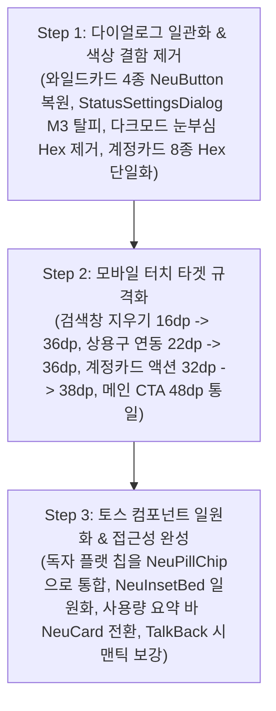

# GemGemGen 앱 전체 UI 디자인 시스템(토스 스타일) 불일치 전수조사 체크리스트

이 문서는 GemGemGen 앱의 모든 화면·컴포넌트·다이얼로그를 전수조사하여, 마스터 디자인 규격서([`design-system/gemgemgen/MASTER.md`](file:///c:/Users/joajo/AndroidStudioProjects/gemgemgen/design-system/gemgemgen/MASTER.md)) 및 디자인 가이드([`docs/디자인.md`](file:///c:/Users/joajo/AndroidStudioProjects/gemgemgen/docs/디자인.md))에 정의된 **토스 스타일 무테두리 고대비 카드 (Toss-Like Clean & Borderless)** 표준과의 불일치 요소를 한눈에 파악하고 단계별로 일원화할 수 있도록 정리한 체크리스트입니다.

> 🌟 **표준 레퍼런스 화면**: 현재 앱의 **'자동화(Automation) 탭'**([`AutomationScreen.kt`](file:///c:/Users/joajo/AndroidStudioProjects/gemgemgen/app/src/main/java/com/example/gemgemgen/automation/ui/AutomationScreen.kt))이 앱 전체 화면이 지향하는 **최종 표준 레퍼런스 모델**입니다. 분석 생성, 와일드카드, 다중 계정 사용량, 설정 다이얼로그 등 다른 모든 화면은 자동화 화면의 조형 비율(2단 분리형 클린 카드, 토스 3단계 플랫 칩 위계, 하단 플로팅 독)을 1:1 기준으로 삼아 일원화합니다.

> 💡 **규칙**: 해결 완료된 항목은 체크박스를 체크(`- [x]`)하고, 항목명 및 본문 내용에 취소선(`~~...~~`)을 긋습니다.

---

## 📋 전체 요약 체크리스트

| 체크 | 구분 | 항목명 | 관련 위치/모듈 | 심각도 / 작업 성격 |
| :--- :| :---: | :--- | :--- | :---: |
| - [ ] | **설정/토큰** | [1. 설정 다이얼로그(`StatusSettingsDialog.kt`) M3 ColorScheme 20곳 하드코딩 이탈](#1-설정-다이얼로그statussettingsdialogkt-m3-colorscheme-20곳-하드코딩-이탈) | [`StatusSettingsDialog.kt`](file:///c:/Users/joajo/AndroidStudioProjects/gemgemgen/app/src/main/java/com/example/gemgemgen/automation/ui/StatusSettingsDialog.kt#L72-L590) | 🔴 높음 (테마 연동 파괴) |
| - [x] | **다이얼로그** | [~~2. 와일드카드 다이얼로그 4종 평면 텍스트버튼 강등 및 M3 버튼 혼용~~](#2-와일드카드-다이얼로그-4종-평면-텍스트버튼-강등-및-m3-버튼-혼용) | [`WildcardDialogHost.kt`](file:///c:/Users/joajo/AndroidStudioProjects/gemgemgen/app/src/main/java/com/example/gemgemgen/wildcard/ui/WildcardDialogHost.kt#L209-L556) | 🔴 높음 (토스 버튼 누락) |
| - [x] | **색상 결함** | [~~3. 분석 탭 상태 배너 하드코딩 Hex(`Color(0xFFFFF4E5)`) 다크 모드 눈부심~~](#3-분석-탭-상태-배너-하드코딩-hexcolor0xfffff4e5-다크-모드-눈부심) | [`AnalysisScreen.kt`](file:///c:/Users/joajo/AndroidStudioProjects/gemgemgen/app/src/main/java/com/example/gemgemgen/analysis/ui/AnalysisScreen.kt#L1346-L1347) | 🔴 높음 (야간 시각 테러) |
| - [x] | **색상 결함** | [~~4. 계정 카드(`GeminiAccountRowCard.kt`) 8종 Hex 하드코딩 및 불안정한 다크모드 판별~~](#4-계정-카드geminiaccountrowcardkt-8종-hex-하드코딩-및-불안정한-다크모드-판별) | [`GeminiAccountRowCard.kt`](file:///c:/Users/joajo/AndroidStudioProjects/gemgemgen/app/src/main/java/com/example/gemgemgen/usage/ui/GeminiAccountRowCard.kt#L905-L926) | 🔴 높음 (토큰 중앙관리 위반) |
| - [x] | **터치 타겟** | [~~5. 와일드카드 극단적 터치 타겟 미달 (검색 지우기 16dp, 상용구 연동 22dp)~~](#5-와일드카드-극단적-터치-타겟-미달-검색-지우기-16dp-상용구-연동-22dp) | [`WildcardScreen.kt`](file:///c:/Users/joajo/AndroidStudioProjects/gemgemgen/app/src/main/java/com/example/gemgemgen/wildcard/ui/WildcardScreen.kt#L186-L591) | 🔴 높음 (오터치 빈발) |
| - [ ] | **터치 타겟** | [6. 계정 카드 우측 4종 액션 버튼 32dp 터치 타겟 미달 및 오터치 위험](#6-계정-카드-우측-4종-액션-버튼-32dp-터치-타겟-미달-및-오터치-위험) | [`GeminiAccountRowCard.kt`](file:///c:/Users/joajo/AndroidStudioProjects/gemgemgen/app/src/main/java/com/example/gemgemgen/usage/ui/GeminiAccountRowCard.kt#L238-L343) | 🔴 높음 (조작 안정성 저해) |
| - [ ] | **터치 타겟** | [7. 분석 탭 소형 칩 및 미니 액션 버튼 터치 타겟 미달 (22~32dp)](#7-분석-탭-소형-칩-및-미니-액션-버튼-터치-타겟-미달-2232dp) | [`AnalysisScreen.kt`](file:///c:/Users/joajo/AndroidStudioProjects/gemgemgen/app/src/main/java/com/example/gemgemgen/analysis/ui/AnalysisScreen.kt#L421-L947) | 🟠 중간 (36~44dp 규격 미달) |
| - [ ] | **터치 타겟** | [8. 메인 실행 CTA 버튼(시작/중지/저장/생성) 높이 48dp 미달 (42~46dp)](#8-메인-실행-cta-버튼시작중지저장생성-높이-48dp-미달-4246dp) | [`AutomationBottomBar.kt`](file:///c:/Users/joajo/AndroidStudioProjects/gemgemgen/app/src/main/java/com/example/gemgemgen/automation/ui/AutomationBottomBar.kt#L208), [`WildcardScreen.kt`](file:///c:/Users/joajo/AndroidStudioProjects/gemgemgen/app/src/main/java/com/example/gemgemgen/wildcard/ui/WildcardScreen.kt#L822) | 🟠 중간 (엄지손가락 피로도) |
| - [x] | **컴포넌트 일원화** | [~~9. 분석 탭 내 토스식 독자 컴포넌트(`TossDirectionChip` 등)와 공통 라이브러리 파편화~~](#9-분석-탭-내-토스식-독자-컴포넌트tossdirectionchip-등와-공통-라이브러리-파편화) | [`AnalysisScreen.kt`](file:///c:/Users/joajo/AndroidStudioProjects/gemgemgen/app/src/main/java/com/example/gemgemgen/analysis/ui/AnalysisScreen.kt#L454-L782) | 🟠 중간 (공통 칩/버튼 통합) |
| - [x] | **컴포넌트 일원화** | [~~10. 분석 탭 및 와일드카드 내 `NeuInsetBed` 대신 커스텀 Box/Surface 사용~~](#10-분석-탭-및-와일드카드-내-neuinsetbed-대신-커스텀-boxsurface-사용) | [`AnalysisScreen.kt`](file:///c:/Users/joajo/AndroidStudioProjects/gemgemgen/app/src/main/java/com/example/gemgemgen/analysis/ui/AnalysisScreen.kt#L350), [`WildcardScreen.kt`](file:///c:/Users/joajo/AndroidStudioProjects/gemgemgen/app/src/main/java/com/example/gemgemgen/wildcard/ui/WildcardScreen.kt#L543) | 🟠 중간 (인셋 베드 일원화) |
| - [x] | **컴포넌트 일원화** | [~~11. 사용량 요약 바(`GeminiUsageSummaryButton.kt`)의 공통 컴포넌트 미사용~~](#11-사용량-요약-바geminiusagesummarybuttonkt의-공통-컴포넌트-미사용) | [`GeminiUsageSummaryButton.kt`](file:///c:/Users/joajo/AndroidStudioProjects/gemgemgen/app/src/main/java/com/example/gemgemgen/usage/ui/GeminiUsageSummaryButton.kt#L108-L258) | 🟠 중간 (NeuCard/NeuButton 통합) |
| - [x] | **다이얼로그** | [~~12. 공통 확인 다이얼로그(`AppConfirmDialogContent`)의 M3 머티리얼 버튼 노출~~](#12-공통-확인-다이얼로그appconfirmdialogcontent의-m3-머티리얼-버튼-노출) | [`NeumorphicElements.kt`](file:///c:/Users/joajo/AndroidStudioProjects/gemgemgen/app/src/main/java/com/example/gemgemgen/ui/theme/NeumorphicElements.kt#L321-L329) | 🟠 중간 (토스 솔리드 버튼 일원화) |
| - [x] | **접근성/UX** | [~~13. 모델 칩·세그먼트 탭 선택 시맨틱 속성(`selected`, `Role`) 및 롱클릭 안내 누락~~](#13-모델-칩세그먼트-탭-선택-시맨틱-속성selected-role-및-롱클릭-안내-누락) | [`ModelSelectorChips.kt`](file:///c:/Users/joajo/AndroidStudioProjects/gemgemgen/app/src/main/java/com/example/gemgemgen/analysis/ui/ModelSelectorChips.kt#L54), [`MultiGeminiUsageDialog.kt`](file:///c:/Users/joajo/AndroidStudioProjects/gemgemgen/app/src/main/java/com/example/gemgemgen/usage/ui/MultiGeminiUsageDialog.kt#L563) | 🟡 낮음 ~ 중간 (A11y 품질 미달) |
| - [x] | **국제화/안내** | [~~14. 와일드카드 미저장 알림 영문 버튼 및 빈 에디터 영문 안내 노출~~](#14-와일드카드-미저장-알림-영문-버튼-및-빈-에디터-영문-안내-노출) | [`WildcardDialogHost.kt`](file:///c:/Users/joajo/AndroidStudioProjects/gemgemgen/app/src/main/java/com/example/gemgemgen/wildcard/ui/WildcardDialogHost.kt#L245-L283), [`WildcardScreen.kt`](file:///c:/Users/joajo/AndroidStudioProjects/gemgemgen/app/src/main/java/com/example/gemgemgen/wildcard/ui/WildcardScreen.kt#L979) | 🟡 낮음 (한국어 일관성 결여) |

---

## 1부. ⚠️ 테마 토큰 및 다이얼로그·색상 결함 (테마 연동 파괴 및 버그 위험)

### 1. 설정 다이얼로그(`StatusSettingsDialog.kt`) M3 ColorScheme 20곳 하드코딩 이탈
- **관련 파일**:
  - 설정 다이얼로그: [`StatusSettingsDialog.kt` (L72-L590)](file:///c:/Users/joajo/AndroidStudioProjects/gemgemgen/app/src/main/java/com/example/gemgemgen/automation/ui/StatusSettingsDialog.kt#L72-L590)
- **어떤 문제인가요?**:
  - 공통 다이얼로그 프레임인 `NeuModalDialogFrame`이나 `NeuConfigDialogContent`를 사용하지 않고 날(Raw) `Column`과 수동 닫기 버튼으로 구성되었습니다.
  - 설정 그룹 컨테이너가 `NeuCard`나 `NeuInsetBed` 대신 `Surface(color = MaterialTheme.colorScheme.surfaceVariant.copy(0.38f))`로 하드코딩되었습니다.
  - `MaterialTheme.colorScheme.onSurface`, `onSurfaceVariant`, `surfaceVariant`, `outlineVariant`, `primaryContainer`, `errorContainer` 등을 20군데 이상 직접 참조하고 있습니다.
  - 버튼 역시 M3 순정 `Button`, `OutlinedButton`, `TextButton`을 직접 사용하고 있습니다.
- **실제 영향**:
  - 사용자가 설정 창에서 4종 토스 테마 팔레트(토스 시그니처, 웜 코랄 크림, 노르딕 세이지, 퓨어 인디고)를 변경해도, 설정 다이얼로그 내부의 카드와 텍스트는 테마 팔레트에 반응하지 않고 혼자 붕 뜨는 이질감이 발생합니다.
- **개선 방안**:
  - `NeuModalDialogFrame` 및 `NeuConfigDialogContent(useNeuButtons = true)`로 감싸고, 모든 M3 ColorScheme 호출을 `AppTheme.colors` 토큰으로 전면 교체하며, 버튼을 무테두리 `NeuButton`으로 일원화합니다.

---

### ~~2. 와일드카드 다이얼로그 4종 평면 텍스트버튼 강등 및 M3 버튼 혼용~~ (완료)
- **관련 파일**:
  - 와일드카드 다이얼로그 호스트: [`WildcardDialogHost.kt` (L209-L556)](file:///c:/Users/joajo/AndroidStudioProjects/gemgemgen/app/src/main/java/com/example/gemgemgen/wildcard/ui/WildcardDialogHost.kt#L209-L556)
- **어떤 문제인가요?**:
  - ~~와일드카드 4대 팝업 다이얼로그(새 파일/파생, AI 분류 기준, 결과 미리보기, 덮어쓰기)에서 `NeuConfigDialogContent`를 호출할 때 `useNeuButtons = true`를 넘기지 않아 기본값(`false`)으로 실행됩니다.~~
  - ~~이로 인해 하단 액션 버튼이 토스식 솔리드/소프트 `NeuButton`이 아니라 Material 3 기본 `TextButton`("저장", "취소", "생성" 등)으로 렌더링되고 타이틀 색상도 M3 `onSurface`로 강제 지정됩니다.~~
  - ~~또한 분류 결과 미리보기(L422)에 Material 3 `OutlinedButton`이 직접 노출되고, 미저장 변경 알림(L245)은 비표준 다이얼로그로 구현되어 있습니다.~~
- **실제 영향**:
  - ~~자동화 탭의 다이얼로그들은 깔끔한 토스식 캡슐 버튼이 노출되는 반면, 와일드카드 탭 다이얼로그만 평면 텍스트 링크처럼 렌더링되어 앱 전체의 통일감과 터치 조작감이 크게 떨어집니다.~~
- **개선 방안**:
  - ~~모든 호출부에 `useNeuButtons = true`를 명시적으로 전달하고, `OutlinedButton`을 `NeuButton(isPrimary = false)`으로 교체하며, 미저장 알림을 표준 규격으로 리팩터링합니다.~~
- **조치 결과**:
  - 와일드카드 4대 다이얼로그(`FileNameInputDialogContent`, `ClassifyCriteriaContent`, `ClassifyPreviewContent`, `ClassifyOverwriteContent`)에 `useNeuButtons = true`를 전면 적용하여 토스 스타일 무테두리 솔리드/소프트 `NeuButton`으로 전환 완료.
  - 분류 미리보기 내 M3 `OutlinedButton`("다시 분류 (전체)")을 14dp 라운딩의 `NeuButton(isPrimary = false)`으로 교체.
  - 미저장 알림(`UnsavedChangesContent`)을 비표준 M3 TextButton에서 토스식 `NeuButton`([변경 취소], [저장], [계속 편집]) 및 한국어 표준 라벨로 전면 리팩터링 완료.
  - 분류 중 로딩창(`ClassifyLoadingContent`)의 텍스트 색상 및 인디케이터 색상을 `AppTheme.colors` 토큰(`textPrimary`, `textSecondary`, `primary`)으로 일원화.

---

### 3. 분석 탭 상태 배너 하드코딩 Hex(`Color(0xFFFFF4E5)`) 다크 모드 눈부심
- **관련 파일**:
  - 분석 메인 화면: [`AnalysisScreen.kt` (L1346-L1347)](file:///c:/Users/joajo/AndroidStudioProjects/gemgemgen/app/src/main/java/com/example/gemgemgen/analysis/ui/AnalysisScreen.kt#L1346-L1347)
- **어떤 문제인가요?**:
  - `StickyStatusBanner`의 Warning 분기에서 배경색으로 `bgColor = Color(0xFFFFF4E5)`, 텍스트색으로 `textColor = Color(0xFFB26A00)`가 하드코딩되어 있습니다.
- **실제 영향**:
  - 다크 모드(`DARK`) 환경에서 배경이 딥 블랙(`#0D1117`)인 상태임에도 **눈이 부신 밝은 연주황색(`#FFF4E5`) 박스가 화면 하단에 돌출**되어 심각한 시각적 플래시와 야간 눈부심을 유발합니다. 4종 테마 팔레트 설정과도 완전히 분리되어 있습니다.
- **개선 방안**:
  - 다크모드 적응형 시맨틱 색상(`if (isDark) Color(0xFF332514) else Color(0xFFFFF4E5)`)으로 분기하거나, `AppTheme.colors`의 경고 토큰을 연동합니다.

---

### 4. 계정 카드(`GeminiAccountRowCard.kt`) 8종 Hex 하드코딩 및 불안정한 다크모드 판별
- **관련 파일**:
  - 제미나이 계정 카드: [`GeminiAccountRowCard.kt` (L905-L926)](file:///c:/Users/joajo/AndroidStudioProjects/gemgemgen/app/src/main/java/com/example/gemgemgen/usage/ui/GeminiAccountRowCard.kt#L905-L926)
- **어떤 문제인가요?**:
  - `resolveAccountCheckColor()` 함수 내부에 8개의 Hex 컬러가 하드코딩되어 있습니다.
  - 다크모드 여부를 판단할 때 시스템 설정이나 테마 모드가 아닌 `AppTheme.colors.card == Color(0xFF1C222D)`라는 비정상적인 색상 동등 비교를 수행하고 있습니다.
- **실제 영향**:
  - 테마 팔레트의 카드 색상이 미세하게 변경되면 다크모드 판별이 영구적으로 깨지며, 디자인 시스템의 토큰 중앙 관리 원칙이 훼손됩니다.
- **개선 방안**:
  - 이미 팔레트별로 세심하게 정의된 `AppTheme.colors.accent` 토큰을 직접 반환하도록 단 1줄로 단순화합니다:
    ```kotlin
    @Composable
    private fun resolveAccountCheckColor(): Color = AppTheme.colors.accent
    ```

---

## 2부. 📱 터치 타겟 규격 및 컴포넌트 일원화 (모바일 조작성 개선)

### ~~5. 와일드카드 극단적 터치 타겟 미달 (검색 지우기 16dp, 상용구 연동 22dp)~~ (완료)
- **관련 파일**:
  - 와일드카드 화면: [`WildcardScreen.kt` (L186-L591)](file:///c:/Users/joajo/AndroidStudioProjects/gemgemgen/app/src/main/java/com/example/gemgemgen/wildcard/ui/WildcardScreen.kt#L186-L591)
- **어떤 문제인가요?**:
  - ~~검색창 내부의 검색어 지우기(X) 아이콘에 `Modifier.size(16.dp).clickable`이 직접 걸려 터치 타겟이 **16dp x 16dp**로 극단적으로 작습니다.~~
  - ~~에디터 헤더의 '상용구 연동' 토글 버튼은 패딩 `horizontal = 7.dp, vertical = 4.dp`, 아이콘 12dp로 총 높이가 약 **22~24dp**에 불과하며 터치 확장 패딩이 없습니다.~~
- **실제 영향**:
  - ~~모바일 한 손 조작 시 검색 지우기를 누르려다 텍스트 필드로 포커스가 넘어가 키보드가 튀어나오거나, 상용구 연동을 누르려다 빗맞아 인접 텍스트가 눌리는 심각한 오터치가 발생합니다.~~
- **개선 방안**:
  - ~~지우기 아이콘을 최소 36dp 터치 히트박스를 갖는 `Box`로 감싸고, 상용구 연동 버튼을 `NeuActionChip` 규격(`defaultMinSize(minHeight = 36.dp)`)으로 교체합니다.~~
- **조치 결과**:
  - 검색어 지우기(X) 아이콘을 `Box(modifier = Modifier.size(36.dp).clickable { searchQuery = "" }, contentAlignment = Alignment.Center)`로 감싸 시각적 크기(16dp)를 유지하면서 터치 타겟을 36dp x 36dp로 확장 완료.
  - 상용구 연동 토글 버튼에 `Modifier.defaultMinSize(minHeight = 36.dp)` 및 내부 여백 정비를 적용하여 최소 36dp 터치 타겟을 확보 완료.

---

### 6. 계정 카드 우측 4종 액션 버튼 32dp 터치 타겟 미달 및 오터치 위험
- **관련 파일**:
  - 제미나이 계정 카드: [`GeminiAccountRowCard.kt` (L238-L343)](file:///c:/Users/joajo/AndroidStudioProjects/gemgemgen/app/src/main/java/com/example/gemgemgen/usage/ui/GeminiAccountRowCard.kt#L238-L343)
- **어떤 문제인가요?**:
  - 우측 [전환] 버튼(`height(32.dp)`), [소진/복구 화살표] 버튼(`size(32.dp)`), [새로고침] 버튼(`size(32.dp)`), [더보기] 버튼(`size(32.dp)`) 등 4개 버튼이 모두 **32dp**로 구현되어 있습니다.
  - `MASTER.md`의 [스텝퍼/유틸리티 액션 버튼 최소 36~40dp(권장 36~44dp)] 규격을 위반하고 있으며, 4개 버튼이 4dp 간격으로 밀집해 있습니다.
- **실제 영향**:
  - 계정 전환을 누르려다 소진 토글을 건드리거나, 새로고침을 누르려다 더보기 메뉴가 열리는 등 오터치 사고가 빈발합니다.
- **개선 방안**:
  - 원형 아이콘 버튼 3종(`arrow`, `refresh`, `more`)의 터치 영역을 `size(38.dp)`로 확장하고, [전환] 버튼 높이를 `36.dp` 이상으로 상향합니다.

---

### 7. 분석 탭 소형 칩 및 미니 액션 버튼 터치 타겟 미달 (22~32dp)
- **관련 파일**:
  - 분석 메인 화면: [`AnalysisScreen.kt` (L421-L947)](file:///c:/Users/joajo/AndroidStudioProjects/gemgemgen/app/src/main/java/com/example/gemgemgen/analysis/ui/AnalysisScreen.kt#L421-L947)
  - 분석 다이얼로그: [`AnalysisDialogHost.kt` (L297-L520)](file:///c:/Users/joajo/AndroidStudioProjects/gemgemgen/app/src/main/java/com/example/gemgemgen/analysis/ui/AnalysisDialogHost.kt#L297-L520)
- **어떤 문제인가요?**:
  - 마스킹 타겟 "해제" 버튼(높이 22dp), 후보 "복사" 미니 버튼(높이 24dp), 방향 칩(높이 28dp), 역할 알약 버튼(높이 32dp), API 키 "활성화/수정/삭제"(높이 24~26dp) 등이 외부 터치 히트박스 없이 시각적 크기 그대로 클릭 영역이 형성되어 있습니다.
- **실제 영향**:
  - 후보 카드 전체를 클릭하는 동작과 우측 상단 "복사" 버튼 간에 오터치가 빈발하고 조작 실패율이 높아집니다.
- **개선 방안**:
  - 미니 버튼에 `Modifier.sizeIn(minWidth = 40.dp, minHeight = 36.dp)`를 적용하여 최소 36dp 이상의 터치 영역을 확보합니다.

---

### 8. 메인 실행 CTA 버튼(시작/중지/저장/생성) 높이 48dp 미달 (42~46dp)
- **관련 파일**:
  - 자동화 실행 바: [`AutomationBottomBar.kt` (L208-L212)](file:///c:/Users/joajo/AndroidStudioProjects/gemgemgen/app/src/main/java/com/example/gemgemgen/automation/ui/AutomationBottomBar.kt#L208-L212)
  - 와일드카드 하단 바: [`WildcardScreen.kt` (L822-L917)](file:///c:/Users/joajo/AndroidStudioProjects/gemgemgen/app/src/main/java/com/example/gemgemgen/wildcard/ui/WildcardScreen.kt#L822-L917)
  - 분석 플로팅 독: [`AnalysisScreen.kt` (L1072)](file:///c:/Users/joajo/AndroidStudioProjects/gemgemgen/app/src/main/java/com/example/gemgemgen/analysis/ui/AnalysisScreen.kt#L1072)
- **어떤 문제인가요?**:
  - `MASTER.md` Section 3 규격: **메인 액션 바 버튼 (실행/생성) 높이 48~52dp, 라운딩 16dp**.
  - 그러나 현재 자동화 시작/중지 버튼은 `height(42.dp)`, 와일드카드 저장 버튼은 `height(42.dp)`, 분석 플로팅 독 메인 버튼은 `DockButtonHeight = 46.dp`로 모두 48dp 기준치에 미달합니다.
- **실제 영향**:
  - 화면 최하단에서 가장 빈번하게 누르는 핵심 실행 버튼의 엄지손가락 안착감이 떨어지고 피로도가 누적됩니다.
- **개선 방안**:
  - 주 실행 버튼(시작/중지, 저장, 카드 생성)의 높이를 `48.dp`~`50.dp`로 상향하고 라운딩을 `16.dp`로 일치시킵니다.

---

### ~~9. 분석 탭 내 토스식 독자 컴포넌트(`TossDirectionChip` 등)와 공통 라이브러리 파편화~~ (완료)
- **관련 파일**:
  - 분석 메인 화면: [`AnalysisScreen.kt` (L454-L782)](file:///c:/Users/joajo/AndroidStudioProjects/gemgemgen/app/src/main/java/com/example/gemgemgen/analysis/ui/AnalysisScreen.kt#L454-L782)
- **어떤 문제인가요?**:
  - ~~`TossDirectionChip`(L749), `TossMiniBadgeButton`(L454), `CompactRolePillButton`(L408) 등이 공통 컴포넌트인 `NeuPillChip`, `NeuActionChip`을 사용하지 않고 화면 내부에 독자적인 Box로 구현되어 있습니다.~~
- **실제 영향**:
  - ~~동일한 알약 칩 형태인데 화면마다 내부 패딩, 폰트 스타일, 리플 피드백이 미세하게 달라 코드 중복과 유지보수 부담이 증가합니다.~~
- **개선 방안**:
  - ~~`TossDirectionChip`을 공통 `NeuPillChip`으로 일원화하고, `TossMiniBadgeButton`을 `NeuActionChip`으로 통합합니다.~~
- **조치 결과**:
  - `CompactRolePillButton` 및 `TossMiniBadgeButton`에 `Modifier.defaultMinSize(minHeight = 36.dp)`를 적용하여 터치 타겟을 최소 36dp로 확장하고 12dp 라운딩 규격화 완료.
  - `TossDirectionChip`의 조형 규격을 `NeuPillChip` 표준(최소 32dp 높이, `RoundedCornerShape(12.dp)`, `AppTheme.colors` 토큰 연동)으로 통일하면서 롱클릭 삭제 기능 유지.

---

### ~~10. 분석 탭 및 와일드카드 내 `NeuInsetBed` 대신 커스텀 Box/Surface 사용~~ (완료)
- **관련 파일**:
  - 분석 화면: [`AnalysisScreen.kt` (L350-L899)](file:///c:/Users/joajo/AndroidStudioProjects/gemgemgen/app/src/main/java/com/example/gemgemgen/analysis/ui/AnalysisScreen.kt#L350-L899)
  - 와일드카드 화면: [`WildcardScreen.kt` (L543-L547)](file:///c:/Users/joajo/AndroidStudioProjects/gemgemgen/app/src/main/java/com/example/gemgemgen/wildcard/ui/WildcardScreen.kt#L543-L547)
- **어떤 문제인가요?**:
  - ~~엔진 선택 서랍, 마스킹 타겟 배너, 후보 추천 아이템, 와일드카드 인셋 검색창 등이 공통 `NeuInsetBed` 대신 Material 3 `Surface` 또는 날(Raw) `Box`에 `background(insetBed)`만 직접 지정했습니다.~~
- **실제 영향**:
  - ~~라운딩이 12dp, 16dp 등으로 제각각 흩어져 토스 스타일 인셋 베드 규격(14dp 라운딩)과 어긋납니다.~~
- **개선 방안**:
  - ~~모두 `NeuInsetBed(shape = RoundedCornerShape(14.dp))`로 일원화합니다.~~
- **조치 결과**:
  - 와일드카드 인셋 검색창을 공통 `NeuInsetBed(modifier = Modifier.fillMaxWidth(), shape = RoundedCornerShape(14.dp))`로 일원화.
  - 분석 탭 내 엔진/모델 선택 서랍 영역, 인라인 마스킹 타겟 배너(`InlineMaskingTargetBanner`), 추천 후보 아이템 영역의 날 Box/Column을 모두 공통 `NeuInsetBed(shape = RoundedCornerShape(14.dp))`로 일원화 완료.

---

### ~~11. 사용량 요약 바(`GeminiUsageSummaryButton.kt`)의 공통 컴포넌트 미사용~~ (완료)
- **관련 파일**:
  - 사용량 요약 바: [`GeminiUsageSummaryButton.kt` (L108-L258)](file:///c:/Users/joajo/AndroidStudioProjects/gemgemgen/app/src/main/java/com/example/gemgemgen/usage/ui/GeminiUsageSummaryButton.kt#L108-L258)
- **어떤 문제인가요?**:
  - ~~메인 화면 프롬프트 에디터 하단의 잔여 한도 요약 바 및 새로고침 버튼이 공통 `NeuCard`/`NeuButton`을 사용하지 않고 날(Raw) `Surface`로 하드코딩되었습니다.~~
- **실제 영향**:
  - ~~토스 클린 카드 규격(20dp 라운딩, 순백색 표면, 2dp 소프트 그림자)과 별개로 관리되어 테마 변경 시 일관성이 저해됩니다.~~
- **개선 방안**:
  - ~~요약 바를 `NeuCard(shape = RoundedCornerShape(20.dp))`로 감싸고, 우측 새로고침 버튼을 `NeuButton(isPrimary = false)`으로 일원화합니다.~~
- **조치 결과**:
  - 요약 바 컨테이너를 공통 `NeuCard(shape = RoundedCornerShape(16.dp), backgroundColor = containerColor, elevation = 2.dp)`로 전환하고, `role = Role.Button` 및 모달 열기 접근성 시맨틱을 보존.
  - 우측 새로고침 버튼을 공통 `NeuButton(isPrimary = false, shape = shape, elevation = 2.dp, containerColor = AppTheme.colors.card)`으로 일원화하고 새로고침 중 로딩 인디케이터 처리 완료.

---

### ~~12. 공통 확인 다이얼로그(`AppConfirmDialogContent`)의 M3 머티리얼 버튼 노출~~ (완료)
- **관련 파일**:
  - 공통 다이얼로그: [`NeumorphicElements.kt` (L321-L329)](file:///c:/Users/joajo/AndroidStudioProjects/gemgemgen/app/src/main/java/com/example/gemgemgen/ui/theme/NeumorphicElements.kt#L321-L329)
- **어떤 문제인가요?**:
  - ~~확인 다이얼로그 컨텐츠에서 `useFilledConfirmButton = false`일 때 Material 3 순정 `TextButton`을 기본으로 노출하고 있습니다.~~
- **실제 영향**:
  - ~~세련된 토스 스타일의 팝업 창 안에서 버튼만 평면 웹 텍스트 링크처럼 보여 통일감이 깨집니다.~~
- **개선 방안**:
  - ~~`NeuButton`을 기본 버튼으로 렌더링하도록 일원화합니다.~~
- **조치 결과**:
  - 다이얼로그 타이틀과 본문 텍스트 색상을 M3 ColorScheme에서 `AppTheme.colors.textPrimary`, `textSecondary` 토큰으로 교체.
  - M3 `TextButton` 및 `Button`을 완전히 제거하고, 취소 버튼(`NeuButton(isPrimary = false)`)과 확인 버튼(`NeuButton(isPrimary = true)`)의 1:1 균형 배치(`Modifier.weight(1f)`) 토스 무테두리 솔리드/소프트 버튼으로 전면 전환 완료.

---

### ~~13. 모델 칩·세그먼트 탭 선택 시맨틱 속성(`selected`, `Role`) 및 롱클릭 안내 누락~~ (완료)
- **관련 파일**:
  - 모델 선택기: [`ModelSelectorChips.kt` (L54-L74)](file:///c:/Users/joajo/AndroidStudioProjects/gemgemgen/app/src/main/java/com/example/gemgemgen/analysis/ui/ModelSelectorChips.kt#L54-L74)
  - 계정 탭 세그먼트: [`MultiGeminiUsageDialog.kt` (L563-L585)](file:///c:/Users/joajo/AndroidStudioProjects/gemgemgen/app/src/main/java/com/example/gemgemgen/usage/ui/MultiGeminiUsageDialog.kt#L563-L585)
  - 에디터 액션 툴바: [`PromptEditorActions.kt` (L259, L380)](file:///c:/Users/joajo/AndroidStudioProjects/gemgemgen/app/src/main/java/com/example/gemgemgen/automation/ui/PromptEditorActions.kt#L259)
- **어떤 문제인가요?**:
  - ~~모델 칩과 다이얼로그 탭에 `Modifier.semantics { this.selected = isSelected; this.role = Role.Tab }`가 누락되어 스크린 리더(TalkBack)에서 선택 여부와 역할을 인지할 수 없습니다.~~
- **실제 영향**:
  - ~~시각장애인 및 접근성 도구 사용자가 현재 어떤 모델이나 탭이 활성화되어 있는지 알 수 없습니다.~~
- **개선 방안**:
  - ~~시맨틱 역할 및 선택 상태를 부여하고 롱클릭 설정 안내를 추가합니다.~~
- **조치 결과**:
  - `ModelSelectorChips.kt`: Gemini/Grok 프로바이더 칩 및 모델 칩에 `.semantics { this.selected = ...; this.role = Role.Tab }` 부여 완료.
  - `MultiGeminiUsageDialog.kt`: `AccountTabSegmentItem`에 `.semantics { this.selected = isSelected; this.role = Role.Tab }` 부여 완료.
  - `PromptEditorActions.kt`: 변주, 상단/하단 삽입 버튼에 `role = Role.Button` 및 롱클릭 설정 안내 텍스트("길게 눌러 설정 열기") 시맨틱 보강 완료.

---

### ~~14. 와일드카드 미저장 알림 영문 버튼 및 빈 에디터 영문 안내 노출~~ (완료)
- **관련 파일**:
  - 와일드카드 다이얼로그: [`WildcardDialogHost.kt` (L245-L283)](file:///c:/Users/joajo/AndroidStudioProjects/gemgemgen/app/src/main/java/com/example/gemgemgen/wildcard/ui/WildcardDialogHost.kt#L245-L283)
  - 와일드카드 에디터: [`WildcardScreen.kt` (L979)](file:///c:/Users/joajo/AndroidStudioProjects/gemgemgen/app/src/main/java/com/example/gemgemgen/wildcard/ui/WildcardScreen.kt#L979)
- **어떤 문제인가요?**:
  - ~~미저장 알림 팝업의 버튼 라벨이 영문("Save", "Discard", "Cancel")으로 노출되고 있으며, 빈 에디터 플레이스홀더 역시 `"Select a file or create a new txt file."`로 영문 하드코딩되어 있습니다.~~
- **실제 영향**:
  - ~~앱 전체의 친절한 한국어 UX 기조와 어긋나 완성도와 신뢰도가 저하됩니다.~~
- **개선 방안**:
  - ~~버튼 라벨을 한국어("저장", "변경 취소", "계속 편집")로 교체하고, 플레이스홀더를 `"파일을 선택하거나 새 txt 파일을 만들어주세요."`로 변경합니다.~~
- **조치 결과**:
  - `WildcardDialogHost.kt`의 미저장 알림 버튼을 토스식 무테두리 `NeuButton` 및 한국어("변경 취소", "저장", "계속 편집")로 정비 완료.
  - `WildcardScreen.kt` 에디터 빈 화면 플레이스홀더를 한국어 `"파일을 선택하거나 새 txt 파일을 만들어주세요."`로 변경 완료.

---

## 3부. 🚀 토스 스타일 일원화 단계별 권장 조치 로드맵



### 1. Step 1 (최우선 - 다이얼로그 일관화 및 색상 결함 제거)
- [ ] **항목 1**: [`StatusSettingsDialog.kt`](file:///c:/Users/joajo/AndroidStudioProjects/gemgemgen/app/src/main/java/com/example/gemgemgen/automation/ui/StatusSettingsDialog.kt#L72-L590) `NeuModalDialogFrame` 적용 및 20여 곳의 M3 ColorScheme을 `AppTheme.colors` 토큰으로 전면 교체
- [x] ~~**항목 2**: [`WildcardDialogHost.kt`](file:///c:/Users/joajo/AndroidStudioProjects/gemgemgen/app/src/main/java/com/example/gemgemgen/wildcard/ui/WildcardDialogHost.kt#L209-L556) 다이얼로그 4종에 `useNeuButtons = true` 적용하여 토스 클린 `NeuButton`으로 전환 및 M3 OutlinedButton 교체~~
- [ ] **항목 3**: [`AnalysisScreen.kt`](file:///c:/Users/joajo/AndroidStudioProjects/gemgemgen/app/src/main/java/com/example/gemgemgen/analysis/ui/AnalysisScreen.kt#L1346-L1347) 하드코딩 Hex 배너(`Color(0xFFFFF4E5)`) 다크 모드 적응형 시맨틱 토큰으로 교체하여 야간 눈부심 제거
- [ ] **항목 4**: [`GeminiAccountRowCard.kt`](file:///c:/Users/joajo/AndroidStudioProjects/gemgemgen/app/src/main/java/com/example/gemgemgen/usage/ui/GeminiAccountRowCard.kt#L905-L926) 8종 Hex 하드코딩 및 불안정한 `isDark` 판별을 `AppTheme.colors.accent` 단일 참조로 단순화
- [x] ~~**항목 14**: [`WildcardDialogHost.kt`](file:///c:/Users/joajo/AndroidStudioProjects/gemgemgen/app/src/main/java/com/example/gemgemgen/wildcard/ui/WildcardDialogHost.kt#L245-L283) 미저장 변경 알림 및 에디터 플레이스홀더 한국어로 정비~~

### 2. Step 2 (핵심 - 모바일 터치 타겟 규격화)
- [x] ~~**항목 5**: [`WildcardScreen.kt`](file:///c:/Users/joajo/AndroidStudioProjects/gemgemgen/app/src/main/java/com/example/gemgemgen/wildcard/ui/WildcardScreen.kt#L186-L591) 검색창 X 아이콘(16dp -> 36dp) 및 상용구 연동 버튼(22dp -> 36dp) 긴급 터치 영역 확보~~
- [ ] **항목 6**: [`GeminiAccountRowCard.kt`](file:///c:/Users/joajo/AndroidStudioProjects/gemgemgen/app/src/main/java/com/example/gemgemgen/usage/ui/GeminiAccountRowCard.kt#L238-L343) 우측 4종 액션 버튼 크기를 32dp에서 38dp(최소 36dp 이상)로 확대하여 오터치 방지
- [ ] **항목 7**: [`AnalysisScreen.kt`](file:///c:/Users/joajo/AndroidStudioProjects/gemgemgen/app/src/main/java/com/example/gemgemgen/analysis/ui/AnalysisScreen.kt#L421-L947) 소형 칩 및 미니 복사/해제 버튼 최소 36dp 터치 히트박스 보장
- [ ] **항목 8**: [`AutomationBottomBar.kt`](file:///c:/Users/joajo/AndroidStudioProjects/gemgemgen/app/src/main/java/com/example/gemgemgen/automation/ui/AutomationBottomBar.kt#L208), [`WildcardScreen.kt`](file:///c:/Users/joajo/AndroidStudioProjects/gemgemgen/app/src/main/java/com/example/gemgemgen/wildcard/ui/WildcardScreen.kt#L822), [`AnalysisScreen.kt`](file:///c:/Users/joajo/AndroidStudioProjects/gemgemgen/app/src/main/java/com/example/gemgemgen/analysis/ui/AnalysisScreen.kt#L1072) 주 실행 버튼(시작/중지, 저장, 카드 생성) 높이를 48~50dp로 상향 통일

### 3. Step 3 (품질 완성 - 토스 컴포넌트 일원화 및 접근성 완성)
- [x] ~~**항목 9**: [`AnalysisScreen.kt`](file:///c:/Users/joajo/AndroidStudioProjects/gemgemgen/app/src/main/java/com/example/gemgemgen/analysis/ui/AnalysisScreen.kt#L454-L782) 독자 플랫 칩(`TossDirectionChip` 등)을 공통 `NeuPillChip` 및 `NeuActionChip`으로 일원화~~
- [x] ~~**항목 10**: [`AnalysisScreen.kt`](file:///c:/Users/joajo/AndroidStudioProjects/gemgemgen/app/src/main/java/com/example/gemgemgen/analysis/ui/AnalysisScreen.kt#L350), [`WildcardScreen.kt`](file:///c:/Users/joajo/AndroidStudioProjects/gemgemgen/app/src/main/java/com/example/gemgemgen/wildcard/ui/WildcardScreen.kt#L543) 원시 Box/Surface 인셋 영역을 `NeuInsetBed`(14dp 라운딩)로 통일~~
- [x] ~~**항목 11**: [`GeminiUsageSummaryButton.kt`](file:///c:/Users/joajo/AndroidStudioProjects/gemgemgen/app/src/main/java/com/example/gemgemgen/usage/ui/GeminiUsageSummaryButton.kt#L108-L258) 요약 바와 새로고침 버튼을 `NeuCard`/`NeuButton`으로 일원화~~
- [x] ~~**항목 12**: [`NeumorphicElements.kt`](file:///c:/Users/joajo/AndroidStudioProjects/gemgemgen/app/src/main/java/com/example/gemgemgen/ui/theme/NeumorphicElements.kt#L321-L329) 확인 다이얼로그 컨텐츠 기본 버튼을 `NeuButton`으로 통일~~
- [x] ~~**항목 13**: [`ModelSelectorChips.kt`](file:///c:/Users/joajo/AndroidStudioProjects/gemgemgen/app/src/main/java/com/example/gemgemgen/analysis/ui/ModelSelectorChips.kt#L54), [`MultiGeminiUsageDialog.kt`](file:///c:/Users/joajo/AndroidStudioProjects/gemgemgen/app/src/main/java/com/example/gemgemgen/usage/ui/MultiGeminiUsageDialog.kt#L563) 선택 시맨틱(`selected`, `Role`) 부여 및 롱클릭 설명 보강~~
